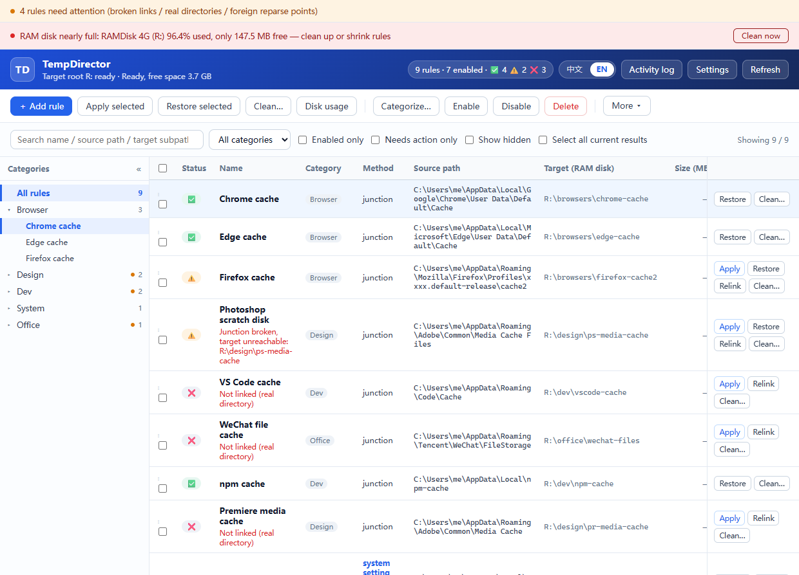
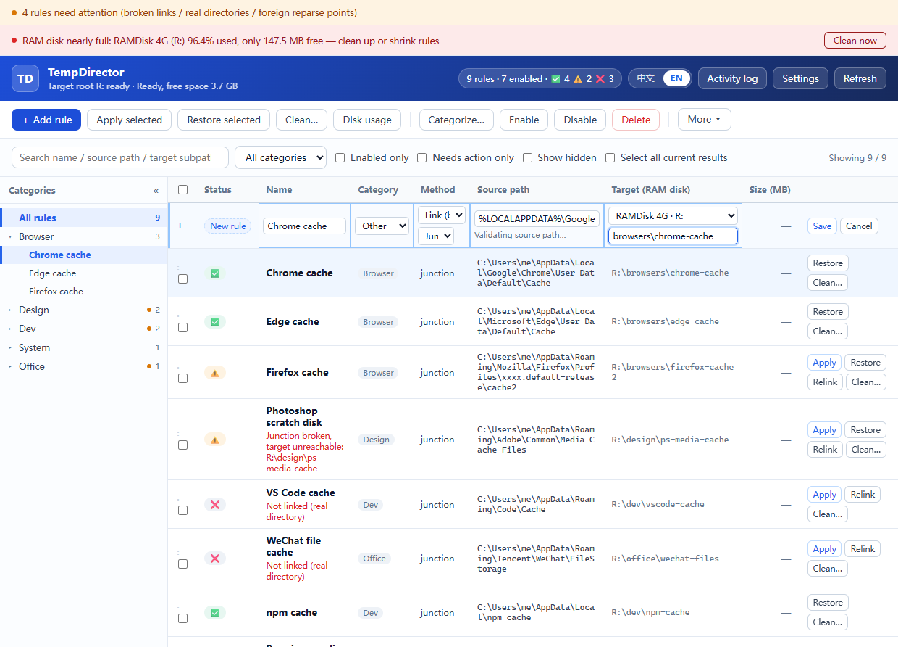
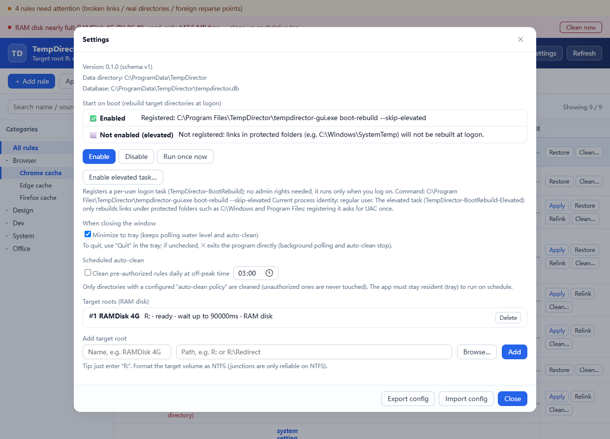
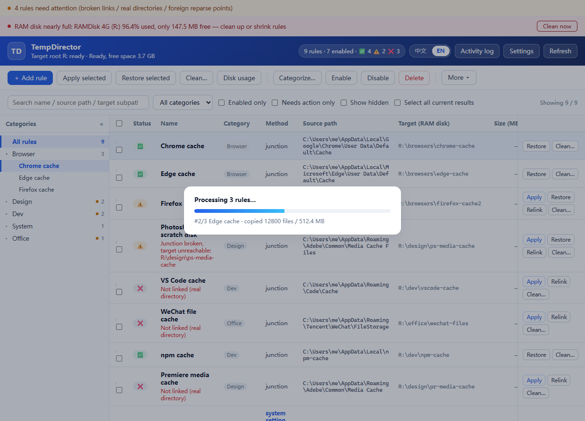

[中文](README_ZH.md) | **English**

# SubLink

[](https://github.com/natureanalysis/SubLink/actions/workflows/ci.yml)
[](https://github.com/natureanalysis/SubLink/releases)
[](LICENSE)

**A Windows symbolic-link manager.** SubLink redirects the cache and temp directories
of desktop applications to a RAM disk with directory junctions, then rebuilds that
directory tree on the RAM disk at every logon — cutting SSD writes while hot cache I/O
stays in memory. Junctions don't need `SeCreateSymbolicLinkPrivilege`, so the normal case
runs with zero UAC prompts; elevation happens on demand only when a source path sits under
`Program Files` / `ProgramData` or another protected location.

For system locations that are better redirected by configuration than by a link — the
temp directory, for instance — a rule can instead rewrite the `TEMP` / `TMP` environment
variable directly (no junction, no reparse point). See
[Redirecting by system settings instead of links](#redirecting-by-system-settings-instead-of-links).

> **Upgrading from TempDirector**: the project has been renamed to SubLink. On first
> launch, `%PROGRAMDATA%\TempDirector` is moved as a whole to `%PROGRAMDATA%\SubLink`
> (database files are renamed too); if the old directory is locked and the move fails,
> SubLink keeps using it rather than leaving a half-copied data set behind. The portable
> `TEMPDIRECTOR_DATA_DIR` / `TEMPDIRECTOR_LANG` variables are still honored. The three
> scheduled tasks are now `SubLink-BootRebuild*`: re-enable autostart once after upgrading
> (doing so also removes the old tasks).

---

## Desktop UI

The UI speaks **中文 / English** — the segmented switch sits at the top right. First
launch defaults to English, and the choice is remembered.

> Screenshots below were taken before the rename; the brand name in the title bar follows
> the installed build.

**Main window**:



* **Rule list**: status icons only (✅ OK / ⚠️ broken link or empty target / ❌ not linked /
  🚫 foreign reparse point; hover for the full explanation), source → target paths side by side,
  wanted/boot-rebuild flags;
  search, category filter and "needs attention only" narrow the list; checked rows drive
  batch actions (apply / restore / **categorize** / enable / disable / relink / delete); **right-click a row**
  for the same per-row actions on that row (or on the whole checked selection, if the row is
  already checked).
  A **Size (MB)** column shows each rule's cache usage; it stays `—` until you press
  **Disk usage** in the toolbar, which fills the column in.
  Presets whose source dir exists on this machine also show up as template rows at the
  bottom of the list (status column shows ＋): check one and press **Apply selected**, or use
  its own **Add & apply**, to create and link it without opening the dialog.
* **Category sidebar**: the “All → category → rule” tree on the left filters by category and
  jumps to a rule; rule nodes can be dragged to reorder within their category and the new
  order is saved automatically (the table’s drag handle shares the same sort order).
* **Add / edit rule (all inline, no dialogs)**: “Add rule” inserts a blank draft row at the
  top of the list; click any cell of an existing rule to edit it in place — name, category,
  link type, source, target root + subpath, flags, auto-clean policy, capacity limit,
  excludes and notes. Enter or blur saves, Esc reverts. Source paths are expanded and validated
  inline; protected paths are marked and blocked. Changing target root / subpath / link type on a
  linked rule removes the old source link and rebuilds it at the new target when saving; only a
  source change prompts you to re-apply. Clicking a built-in template’s name pre-fills the draft row
  instead; ticking it still creates and applies in one step. Clicking another cell while editing
  saves the old cell and opens the new one, and scroll position / focus survive the refresh.
  Low-frequency columns can be hidden under “More → Columns”; the choice is remembered locally.
* **Also**: batch progress overlay, activity log, settings (autostart / scheduled cleaning /
  target roots), and a tray menu.
* **“Undo” button (always in the toolbar, right next to “Delete”)**: a mistyped delete no longer
  means retyping the rule, and a mistyped edit can be taken back too.
  * Deleting is not a real delete — the whole rule row moves to a recycle bin, and “Undo”
    brings it back exactly as it was (same id, same notes, same hidden state). Deleting
    several rules at once restores them as one batch.
  * Edits are undoable as well: after saving, “Undo” puts the fields back to their
    previous values (rename, category, path, notes, the enable switch…). Fields that were
    changed again in the meantime are skipped with a reason, so one undo never wipes out
    your later edits.
  * The undo stack is last-in-first-out: edit → edit → undo takes back the last one, and
    you can keep walking back.
  * The button is greyed out when the stack is empty, and its tooltip says what the next
    undo will do (restore a delete / take back an edit).
  * Directories and links on disk are never touched, so undo needs neither elevation nor
    any data moving. The one exception: when the *target* was changed, the managed link is
    pointed back to the old target.
  * The CLI has the same thing: `sublink rules undo`.







### When the target directory already has content

Applying a rule aborts with “target directory already has content” when the target
directory is not empty — merging would let a newer file from the source overwrite an
older one in the target, which must not happen by default.

Two ways through it:

* **Command line**: `sublink apply <id> --merge` (merges the whole batch).
* **UI**: Settings → “When applying” → “Merge into a target directory that already has
  content”. It is **off** by default; turning it on makes every apply in the UI (the
  elevated path included) merge. The merge rule is **the file with the newer
  modification time wins**; the source is still never deleted before the data check
  passes.

Rules that need elevation go through the UI's best-effort mode (entries that cannot be
copied are skipped, source entries that cannot be deleted stay in place and are
reported). That mode already allows a non-empty target, so it is unaffected by this
switch.

### Build and run

Prebuilt binaries (NSIS installer + portable zip) are on the
[Releases](https://github.com/natureanalysis/SubLink/releases) page.

```powershell
scripts\cargo.cmd build -p sl-gui --release   # output: target\release\sublink-gui.exe
```

The interface is static files embedded into the exe — no npm, no bundler. To preview it
without Tauri, open `crates/sl-gui/ui/index.html?mock=1` in a browser (add `&progress=1` /
`&add=1` / `&settings=1` / `&ops=1` for the overlays and inline draft row).

---

## Autostart and elevation

Register a per-user logon task (no admin rights needed) to rebuild the RAM-disk tree
automatically at every logon:

```powershell
sublink autostart enable     # afterwards every logon rebuilds automatically
sublink autostart status     # inspect: registered? running what?
sublink autostart run        # trigger one run now, to verify
sublink autostart disable    # remove
```

The task action is `<GUI path> boot-rebuild`; portable setups also get `--data-dir` baked
into the task, because scheduled tasks don't inherit your shell's environment variables.
Failures are never silent: the report is stored in the database and written to
`logs/boot-rebuild.log`, and the UI shows a banner on next open.

### Three boot tasks, three jobs

| Task | Trigger | Identity | Scope | Purpose |
|---|---|---|---|---|
| `SubLink-BootRebuild` | logon | current user (least privilege) | normal sources | rebuild ordinary cache directories |
| `SubLink-BootRebuild-Elevated` | logon | current user (highest) | protected sources (`C:\Windows`, …) | rebuild links under protected folders |
| `SubLink-BootRebuild-Startup` | **system startup** | **SYSTEM** | system-setting rules | create the directory a machine-level env var points at, before anyone logs on |

The third one exists for **system-setting** rules: a machine-level `TEMP`/`TMP` is a persistent
value in the registry and survives the reboot, but the directory it points at lives on the
RAM disk — and the RAM disk is empty after a reboot. Logon tasks run *after* someone logs in,
yet boot services, installers and updaters are already using `%TEMP%` by then; with the variable
pointing at a directory that does not exist, writing a temporary file simply fails. So this task
uses a **system startup trigger as SYSTEM** to create that directory before logon.
It only handles system-setting rules on purpose: link-mode rules expand their source path from
variables such as `%LOCALAPPDATA%`, which resolve to the systemprofile under SYSTEM — wrong paths.

```powershell
sublink autostart enable --startup    # register the system startup task (asks for UAC)
sublink autostart disable --startup   # remove it
sublink boot-rebuild --setting-only   # run that scope by hand
```

Directory junctions themselves need no privileges, but writing caches under
`C:\Program Files` / `C:\ProgramData` / `C:\Windows` needs admin rights. Such rules are
marked in the UI, and a batch apply offers to elevate through a **one-shot worker**: a job
file containing **rule ids only — no paths**, required to live inside `<data dir>\jobs\`,
relaunching itself via `ShellExecuteExW(runas)` and re-running the exact same safety checks
as the GUI/CLI (blacklist, self-loop, occupancy detection). A job placed anywhere else is
rejected with exit code 1.

---

## Quick start

```powershell
# 1) Build (the script fills in the MSVC + Rust toolchain environment itself)
scripts\cargo.cmd build --release
# output: target\release\sublink.exe

# 2) Register the RAM disk as a target root
sublink roots add RAMDisk "R:"

# 3) Add a rule (source paths support %VAR% templates, expanded per user on import)
sublink rules add "Chrome cache" `
  "%LOCALAPPDATA%\Google\Chrome\User Data\Default\Cache" `
  "browsers\chrome-cache" --category browser --enable

# 4) Inspect first: health check + occupancy + dry run
sublink status --all
sublink locks "<rule id of the Chrome cache rule>"
sublink apply --all --dry-run

# 5) Run for real (checks occupancy first; aborts without touching anything when occupied)
sublink apply --all

# 6) Boot rebuild
sublink boot-rebuild

# 7) Undo by restoring
sublink restore --all
```

> The data directory defaults to `%PROGRAMDATA%\SubLink`. Override it with the
> `SUBLINK_DATA_DIR` environment variable or the `--data-dir` argument.

---

## Command reference

```
overview
  doctor                     environment self-check: data dir, link capability, target volumes, rule states,
                             env vars (system-setting mode: current value + registry type + expected value),
                             pending fixes
  version

target roots (RAM disk)
  roots list
  roots add <name> <path> [--timeout ms] [--hdd]
  roots rm <id>
  volume <R: or R:\Dir> [--timeout ms]        probe / wait for the volume to be ready

rules
  rules list [--enabled] [--category cat] [--search term] [--json]
  rules add <name> <source template> <target subpath> [--root id] [--category cat]
            [--link-type junction|symlink_dir] [--enable] [--no-boot] [--notes note]
            [--redirect-mode link|setting]          link = junction at the source (default)
                                                  setting = rewrite env vars, no link
            [--env-vars TEMP,TMP]                  vars to rewrite in setting mode
                                                  (TEMP / TMP / LOCALAPPDATA)
            [--env-scope user|machine]             user = HKCU (no elevation)
                                                  machine = HKLM (needs admin)
  rules rm <id...>                                  move to the recycle bin (not a real delete)
  rules undo                                        undo the most recent operation (delete or edit)
  rules enable|disable <id...|--all>

inspection and operations
  status [--enabled|--all] [--category cat] [--search term] [--no-persist] [--json]
  locks <rule id|directory path> [--json]     check occupancy and name the process holding it
  apply <id...|--all> [--dry-run] [--merge] [--sha256] [--skip-lock-check]
  restore <id...|--all> [--dry-run] [--sha256]
  relink <id>                                 rebuild the link only (data untouched)

permissions
  acl check [--json] [--sid <SID>]             check whether the current user has full control over
                                             every target root / target dir / link
  acl fix [--json] [--sid <SID>]               grant the missing permissions (no data moves, volume
                                             roots left alone); --sid pins the account to grant

boot rebuild
  boot-rebuild [--json] [--elevated-only|--skip-elevated|--setting-only]
  autostart status                           whether the "rebuild at logon" task is registered
  autostart enable [--exe <path>]            register (per-user, no admin rights needed)
  autostart enable --elevated                register the elevated task (UAC)
  autostart enable --startup                 register the system startup task (SYSTEM, UAC)
  autostart disable [--elevated|--startup]   unregister (UAC)
  autostart run                              trigger one run manually, to verify

elevation worker (normally not needed manually)
  elevated <job.json>                        run a job as administrator (rule ids only, no paths)

config migration
  export <file.json>
  import <file.json> [--dry-run] [--ram-root R:]

audit
  events [--limit N]
  ops [--limit N]                            operation history (including pending fixes)
```

Category values: built-in categories are `browser` / `design` / `dev` / `system` / `media` / `office` / `game` / `other`;
custom category names are also accepted (select rows in the UI and use “Categorize…” to create one).

---

## Redirecting by system settings instead of links

Most rules redirect a cache directory with a junction. Some system locations — most notably
the **temp directory** — are better handled by rewriting the environment variable itself:
a junction at `%LOCALAPPDATA%\Temp` does not move what the OS itself considers "the temp
directory", whereas pointing `TEMP` / `TMP` at the RAM disk does.

Add such a rule with `--redirect-mode setting`:

```powershell
sublink rules add "User TEMP" `
  "%LOCALAPPDATA%\Temp" `
  "system\temp" --redirect-mode setting --env-vars TEMP,TMP --env-scope user
```

* **`--redirect-mode`** — `link` (default, junction at the source) or `setting`
  (rewrite environment variables, **no link is created**). Existing rules and old config
  files always stay in `link` mode.
* **`--env-vars`** — which variables to rewrite. Whitelist: `TEMP`, `TMP`.
  `LOCALAPPDATA` is deliberately **not** allowed: it is computed by the Shell
  rather than stored as a registry environment variable, and it holds
  irreplaceable user data (browser bookmarks, passwords) — redirecting it to a
  RAM disk would lose that data on every reboot. `PATH` and friends are
  rejected outright.
* **`--env-scope`** — `user` writes `HKCU\Environment` (no elevation needed);
  `machine` writes `HKLM\SYSTEM\CurrentControlSet\Control\Session Manager\Environment`
  and therefore needs an administrator (the UI offers the one-shot elevation worker).

How it behaves:

1. The data is moved first, then the variables are rewritten, then the source directory
   is deleted — so no process ever writes into a half-migrated directory.
2. The original variable value (including its registry type, `REG_EXPAND_SZ` stays
   `REG_EXPAND_SZ`) is stored in the database when applying, so `restore` puts back
   exactly what was there before.
3. After writing, `WM_SETTINGCHANGE("Environment")` is broadcast. **Already running
   programs keep their old environment block** — restart them (or log off and on) for
   the new value to take effect.

In the UI, the “Method” column shows `junction` / `symlink` or `system setting`; switching
a rule between the two modes, or changing its variables / scope, marks the rule as
needing a re-apply (data is moved, so it is never done silently).

**The “system setting” option is only offered where it can actually work.** The mode
rewrites the value of an environment variable, so it only applies when the source path
is exactly where some `TEMP` / `TMP` currently points — otherwise `apply` is refused by
the safety check (the variable points somewhere else than the rule records). The UI
therefore:

* offers the option, with the variables and scope pre-filled from the feasible
  combination, when the source path is where a `TEMP` / `TMP` points;
* **hides** the option for hard-coded directories (`C:\Windows\Debug` and the like —
  no variable points at them) and shows a one-line note explaining why; such rules can
  only be redirected with a junction;
* keeps the option for a rule that already is in `system setting` mode, with its own
  variables and scope, even if the variables were changed elsewhere.

The CLI's `--redirect-mode setting` is not filtered this way (it is an explicit switch
for scripts), but saving a rule is validated the same way: a source path that does not
match the variable's current value is rejected with an explanation.

---

## Safety rules

1. **Never delete source content before the data check passes.** Cross-volume moves always
   go enumerate → copy → verify (file count + bytes, optional SHA-256) → delete source.
2. **Deleting a link removes only the link** — never recurse into a reparse point; doing so
   would wipe the real data on the RAM disk.
3. **Never touch what you don't understand.** Foreign reparse points (OneDrive placeholders,
   `AppExecLink`, mount points) are reported, not processed; when a software update replaces
   a link with a real directory, the boot guardian only warns and leaves it to a human.

See [`docs/ARCHITECTURE.md`](docs/ARCHITECTURE.md) (Chinese) for 20+ edge cases.

---

## Repository layout

```
crates/
  sl-core/                 engine library (no GUI dependencies)
    src/util.rs            path normalization, \\?\ long paths, env var expansion, volume detection
    src/safety.rs          rule blacklist (volume roots / system dirs / self-loops)
    src/link/              reparse point identification, Junction create/remove
    src/sysenv.rs          environment variable read/write (HKCU / HKLM) + WM_SETTINGCHANGE broadcast
    src/fsops/             occupancy detection (+Restart Manager), safe moving, merging, verification
    src/engine.rs          orchestration: decision tree → move → link → rollback → persist
    src/store/             SQLite schema / migrations / DAO / operation history
    src/boot/              waiting for volume readiness, batch rebuild at boot, DACL re-apply
    src/autostart.rs       logon task register / query / remove (schtasks + task XML)
    src/elevate.rs         elevation state detection, launching a process as admin and waiting
    src/worker.rs          the elevation worker's job protocol and executor (the trust anchor)
    src/portable.rs        config import / export
    presets.json           built-in preset list (cache dirs of common apps, embedded at compile time)
  sl-cli/                  sublink.exe (management / elevation worker / boot rebuild)
  sl-gui/                  sublink-gui.exe (Tauri 2 UI)
    src/api.rs             business layer: takes &Store, emits serde structs (unit-testable without a window)
    src/commands.rs        thin #[tauri::command] forwarding + progress events + folder dialog
    src/submode.rs         headless submodes: boot-rebuild / elevated (intercepted before Tauri)
    src/lib.rs             entry: submodes → in-memory store fallback → mark_stale_ops → register commands
    src/tray.rs            tray menu (show window / rebuild now / quit)
    ui/                    index.html / style.css / app.js (static files, embedded at compile time)
docs/ARCHITECTURE.md       architecture and edge cases (Chinese)
docs/screenshots/          UI screenshots (one Chinese set + one English set: main-window / add-rule / settings / progress)
scripts/cargo.cmd          dev build wrapper (fills in MSVC + Rust environment)
scripts/make_icon.py       app icon generation (pure PIL, re-runnable)
scripts/take-screens.cjs   UI screenshot generation (mock data + headless browser, Chinese and English sets, re-runnable)
rebuild.bat                one-click full rebuild (clean + release) and desktop shortcut refresh
```

---

## Preset rules

The "Add rule" dialog offers a **preset dropdown** with cache-directory templates for
common apps, merged from two layers:

1. **Built-in** — `crates/sl-core/presets.json`, embedded at compile time (editing it
   requires a rebuild).
2. **User-external** — `presets.json` in the data directory (`%PROGRAMDATA%\SubLink`,
   or the `SUBLINK_DATA_DIR` directory in portable mode). Same format, no rebuild:

```json
[
  {
    "name": "My app cache",
    "category": "dev",
    "source_template": "%LOCALAPPDATA%\\MyApp\\Cache",
    "target_subpath": "dev\\myapp-cache",
    "note": "optional hint"
  }
]
```

A user entry whose `source_template` matches a built-in one (case-insensitive)
**overrides** it; the rest are appended. Only entries whose source directory actually
exists on this machine are shown. The chain is covered by the integration test
`crates/sl-gui/tests/preset_override.rs`.

---

Besides the dialog dropdown, presets whose source directory exists on this machine are
rendered **directly as template rows at the bottom of the rule list** (badge "➕ Not added"):
check one and press **Apply selected**, or click the row's own **Add & apply**, to create and
link it with the template defaults (junction, wanted on, rebuild on boot) — no dialog, no
manual add step. Templates matching a `source_template` that already has a rule are hidden.

## Development

```powershell
scripts\cargo.cmd check --workspace --all-targets
scripts\cargo.cmd test  --workspace          # 340 tests (unit: sl-core 292, sl-cli 11, sl-gui 9; integration: 28)
scripts\cargo.cmd build --release            # both exes at once
rebuild.bat                                  # full rebuild: clean + release + refresh the desktop shortcut
python scripts\make_icon.py                  # regenerate the app icon
```

`scripts/cargo.cmd` wraps cargo to fill in the MSVC + Rust toolchain environment
(`vcvars64.bat`, `PATH`, `RUSTUP_HOME` / `CARGO_HOME`); keep it pure ASCII — `cmd.exe`
reads batch files with an OEM code page. `rebuild.bat` also refreshes the desktop shortcut
after a clean rebuild, since `cargo clean` wipes `target\` and any earlier .lnk would
dangle.

Retaking the UI screenshots for this README (mock data + headless browser, no Tauri):

```powershell
# requires playwright (npm i playwright); uses the Edge / Chrome already installed
node scripts\take-screens.cjs --lang en     # English set
node scripts\take-screens.cjs --lang zh     # Chinese set
node scripts\take-screens.cjs --lang en --check   # scan for missing translations only
```

The script reuses the Edge / Chrome already installed on the machine, so the
playwright browser download is not needed — install the package only and skip it:

```powershell
$env:PLAYWRIGHT_SKIP_BROWSER_DOWNLOAD='1'
npm install --prefix R:\tmp\td_pw playwright
$env:NODE_PATH='R:\tmp\td_pw\node_modules'   # so node can resolve playwright
node scripts\take-screens.cjs --lang zh
```

### About the tauri version

Pin the whole family together — `tauri 2.11.5 / tauri-build 2.6.3 / tauri-codegen 2.6.3 /
tauri-macros 2.6.3 / tauri-plugin 2.6.3 / tauri-utils 2.9.3 / tauri-runtime 2.11.3 /
tauri-runtime-wry 2.11.4 / wry 0.55.1`. The transitive crates are range dependencies, so
bumping only the main crate breaks the build with errors like
`no variant named UnexpectedMenuKind`; move the whole set with `cargo update -p <crate>
--precise <ver>`.
