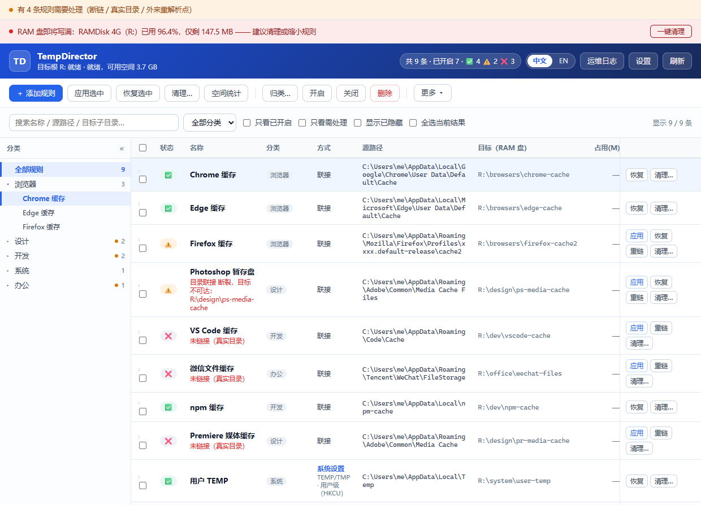
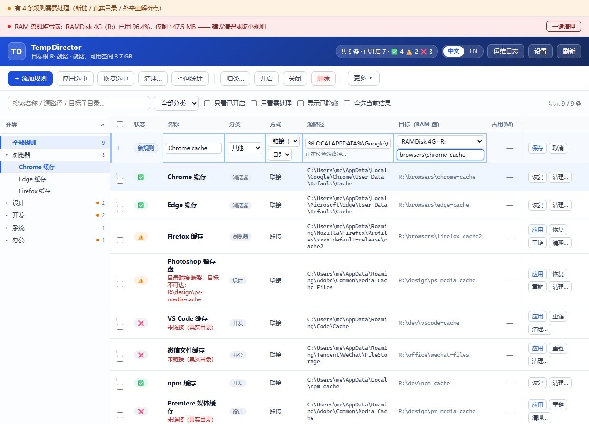
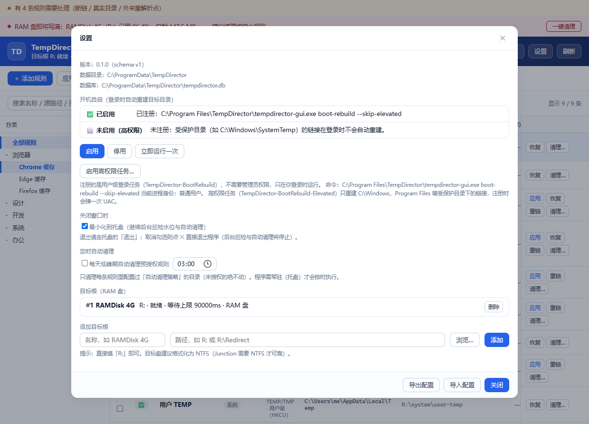
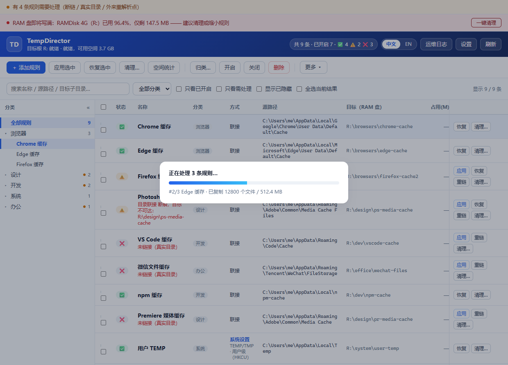

**中文** | [English](README.md)

# SubLink

[](https://github.com/natureanalysis/SubLink/actions/workflows/ci.yml)
[](https://github.com/natureanalysis/SubLink/releases)
[](LICENSE)

**一款 Windows 软链接管理软件。** SubLink 用目录 Junction 把上百款桌面软件的
缓存 / 临时目录重定向到 RAM 盘，并在每次登录后把 RAM 盘上的目录树重建出来 —— 既减少
SSD 写入，又让高频缓存读写发生在内存里。Junction 不需要 `SeCreateSymbolicLinkPrivilege`，
常规场景零 UAC 弹窗；只有源路径位于 `Program Files` / `ProgramData` 等受保护位置时才按需提权。

对于「临时目录」这类更适合改配置而不是挂链接的系统位置，规则可以直接重写
`TEMP` / `TMP` 环境变量（不建 Junction、不留重解析点），见
[用「系统设置」重定向，而不是挂链接](#用系统设置重定向而不是挂链接)。

> **从 TempDirector 升级**：项目已更名为 SubLink。首次启动时会把
> `%PROGRAMDATA%\TempDirector` 整体迁移到 `%PROGRAMDATA%\SubLink`（连库文件一起改名）；
> 若旧目录被占用导致迁移失败，则继续使用旧目录，不会产生半套数据。
> 便携模式用的 `TEMPDIRECTOR_DATA_DIR` / `TEMPDIRECTOR_LANG` 仍然会被读取。
> 三个计划任务改名为 `SubLink-BootRebuild*`：升级后请在设置里重新启用一次开机自启，
> 重新启用时会顺带清掉旧任务。

---

## 桌面界面

界面支持 **中文 / English**：右上角分段按钮切换，首次启动默认英文，选择会记住。

> 下方截图为更名前拍摄，界面顶栏品牌名以实际安装版本为准。

**主界面**：



* **规则列表**：状态列只显示图标（✅ 正常 / ⚠️ 断链或目标空 / ❌ 未链接 / 🚫 外来重解析点，
  悬停看完整说明）、源路径 → 目标路径并排、期望开关与开机重建旗标；搜索、分类筛选、只看需处理快速收敛；
  勾选后批量操作（应用 / 恢复 / **归类** / 开启 / 关闭 / 仅重建链接 / 删除）；**在行上右键**可就地对该条
  （若该条已勾选，则对已勾选的一批）执行同样的行级操作。
  **「占用(M)」列**显示每条规则缓存目录的当前占用（MB），点工具栏「空间统计」后回填，未统计时显示 `—`。
  列表末尾直接列出本机可用的**内置模板**（状态列显示 ＋），勾选后随「应用选中」
  一并建规则 + 建链，不必先开弹窗手动添加。
* **分类侧栏**：左侧「全部 → 分类 → 规则」树，点分类筛选、点规则定位到对应行；规则节点可在
  同一分类内直接拖拽重排，顺序自动写库（与表格把手的拖拽共用同一套排序）。
* **添加 / 编辑规则（全部在列表里完成，不弹对话框）**：点「添加规则」会在列表顶部插入一条
  空白草稿行，直接在行内填写；已有规则单击任意字段单元格即可编辑（名称 / 分类 / 链接类型 /
  源路径 / 目标根与子目录 / 旗标 / 自动清理策略 / 容量上限 / 排除 / 备注），回车或失焦保存，
  Esc 撤销。源路径在单元格内实时展开校验，受保护路径会标红并阻止保存；已建链规则改目标根 /
  目标子目录 / 链接类型后，保存时会自动删掉源路径上的旧链接并按新目标重建，只改源路径时仍
  提示重新应用。列表末尾直显的内置模板行同样出自预设清单，点名称可直接预填到
  草稿行改后再存，勾选后也可一步建规则 + 建链。一格还没回车就直接点下一格时，会先保存旧格
  再打开新格；保存 / 刷新后保持滚动位置和焦点。高频表格可通过「更多 → 显示列」隐藏低频列，
  偏好保存在本地，下次打开仍然生效。
* **其他**：批量进度浮层、运维日志、设置（开机自启 / 定时清理 / 目标根）、托盘菜单。
* **「撤销」按钮（工具栏常驻，紧挨「删除」）**：误删不用重填、误改也能退回去。
  * 删掉的规则**不是真删**：整行搬进回收站，点「撤销」原样搬回（连原 id、备注、
    隐藏态都还在）。一次删多条就整批一起回来。
  * 改过的规则同样能撤：保存后点「撤销」，字段回到上一次的值（改名、改分类、
    改路径、改备注、开关联动都算）。中途又被改过的字段会跳过并说明原因，
  * 免得一次撤销把你后来的修改也抹掉。
  * 撤销栈是后进先出的一条栈：改 → 改 → 撤销，撤的是最后一次；可以一路撤回去。
  * 按钮在撤销栈为空时置灰，悬停会说明这一下会撤什么（恢复删除 / 撤销修改）。
  * 磁盘上的目录与链接从头到尾没被碰过，所以撤销既不需提权也不搬数据；
    唯一的例外是「目标」被改回去了 —— 这时会把链接指回旧目标。
  * 命令行同样有 `sublink rules undo`。







### 目标目录已经有内容时怎么办

应用一条规则时，如果**目标目录里已经有东西**，应用会直接中止并提示
「目标目录已有内容」—— 因为合并意味着目标里的同名旧文件可能被源的新版本覆盖，
这不是该默认发生的事。

两种走法：

* **命令行**：`sublink apply <id> --merge`（同一批规则一起合并）。
* **界面**：设置面板 →「应用时」→「目标目录已有内容时合并进去」。默认**关闭**，
  打开后界面的「应用」（含提权那条路径）都会按合并处理。合并规则是
  **同名文件取修改时间较新者**；数据核对通过之前仍然不会删源。

需要提权的规则在界面上走的是「尽力模式」（拷不动的条目跳过、删不掉的源条目留在原处
并报错），它本身就已经放行了"目标非空"，所以那种路径不受这个开关影响。

### 构建与运行

不想编译？[Releases](https://github.com/natureanalysis/SubLink/releases) 页面直接下载
NSIS 安装包或便携 ZIP。

```powershell
scripts\cargo.cmd build -p sl-gui --release   # 产物：target\release\sublink-gui.exe
```

界面是编译期内嵌进 exe 的静态文件，不需要 npm / 打包器。想不启动 Tauri 单独预览，
直接在浏览器里打开 `crates/sl-gui/ui/index.html?mock=1`（加 `&progress=1` / `&add=1` /
`&settings=1` / `&ops=1` 看各浮层与行内新增草稿）。

---

## 开机自启与提权

注册一个用户级登录任务（不需要管理员权限），即可在每次登录后自动重建 RAM 盘目录树：

```powershell
sublink autostart enable     # 之后每次登录自动重建
sublink autostart status     # 查看是否已注册、跑的是什么命令
sublink autostart run        # 立刻触发一次，验证配置
sublink autostart disable    # 移除
```

任务动作是 `<GUI 路径> boot-rebuild`；便携模式会把 `--data-dir` 一并写进任务（任务计划
不继承 shell 环境变量）。失败不会静默：报告落库并写 `logs/boot-rebuild.log`，界面下次
打开时在顶部横幅提示。

### 三个开机任务，各管一段

| 任务 | 触发 | 身份 | 范围 | 用途 |
|---|---|---|---|---|
| `SubLink-BootRebuild` | 登录 | 当前用户（最低权限） | 普通源 | 重建普通缓存目录 |
| `SubLink-BootRebuild-Elevated` | 登录 | 当前用户（最高权限） | 受保护源（`C:\Windows` 等） | 重建受保护目录下的链接 |
| `SubLink-BootRebuild-Startup` | **系统启动** | **SYSTEM** | 系统设置模式规则 | 登录前把机器级环境变量指向的目录建出来 |

第三个是给**「系统设置模式」**规则准备的：机器级 `TEMP`/`TMP` 是注册表里的持久值，重启不丢，
但它指向的目录在 RAM 盘上 —— RAM 盘重启后是空的。登录任务发生在**登录之后**，那之前
（开机自启服务、安装器、更新程序）已经有进程在用 `%TEMP%` 了，变量指向一个不存在的目录，
写临时文件直接失败。所以这一档用「系统启动触发器 + SYSTEM」在登录前就把目录建出来。
它只处理系统设置模式规则：链接模式规则的源路径靠 `%LOCALAPPDATA%` 之类的变量展开，
在 SYSTEM 上下文里会展开成 systemprofile，路径全错。

```powershell
sublink autostart enable --startup    # 注册系统启动时任务（弹一次 UAC）
sublink autostart disable --startup   # 取消
sublink boot-rebuild --setting-only   # 手动跑一遍这一档
```

目录 Junction 本身免特权，但写 `C:\Program Files` / `C:\ProgramData` / `C:\Windows` 下的
缓存需要管理员权限。这类规则在界面上带标记，批量应用时会询问是否提权。提权走**一次性
worker**：job 文件**只含规则 id、不含路径**，必须位于 `<数据目录>\jobs\` 内，由
`ShellExecuteExW(runas)` 拉起自身，并重跑与 GUI/CLI 完全相同的安全校验（黑名单、自环、
占用检测）；放到别处会以退出码 1 被拒。

---

## 快速开始

```powershell
# 1) 编译（脚本会自己补齐 MSVC + Rust 工具链环境）
scripts\cargo.cmd build --release
# 产物：target\release\sublink.exe

# 2) 注册 RAM 盘作为目标根
sublink roots add RAMDisk "R:"

# 3) 加一条规则（源路径支持 %VAR% 模板，导入库时按当前用户展开）
sublink rules add "Chrome 缓存" `
  "%LOCALAPPDATA%\Google\Chrome\User Data\Default\Cache" `
  "browsers\chrome-cache" --category browser --enable

# 4) 先看体检结果 + 占用情况 + 预演
sublink status --all
sublink locks "Chrome 缓存对应的规则 id"
sublink apply --all --dry-run

# 5) 真正执行（会先检测占用，被占用就中止且不做任何改动）
sublink apply --all

# 6) 开机重建
sublink boot-rebuild

# 7) 想撤销就恢复
sublink restore --all
```

> 数据目录默认是 `%PROGRAMDATA%\SubLink`，可用环境变量 `SUBLINK_DATA_DIR`
> 或参数 `--data-dir` 覆盖。

---

## 命令一览

```
概览
  doctor                     环境自检：数据目录、链接能力、目标盘、规则状态、
                             环境变量（系统设置模式：当前值 + 注册表类型 + 期望值）、
                             待修复项
  version

目标根（RAM 盘）
  roots list
  roots add <名称> <路径> [--timeout 毫秒] [--hdd]
  roots rm <id>
  volume <R: 或 R:\Dir> [--timeout 毫秒]        探测 / 等待卷就绪

规则
  rules list [--enabled] [--category 分类] [--search 关键词] [--json]
  rules add <名称> <源路径模板> <目标子目录> [--root id] [--category 分类]
            [--link-type junction|symlink_dir] [--enable] [--no-boot] [--notes 备注]
            [--redirect-mode link|setting]          link=在源路径建 Junction（默认）
                                                  setting=直接改系统环境变量（不建链接）
            [--env-vars TEMP,TMP]                  setting 模式要改的环境变量（逗号分隔）
                                                  可选：TEMP / TMP / LOCALAPPDATA
            [--env-scope user|machine]             user=HKCU（当前用户，免提权）
                                                  machine=HKLM（全机，需管理员）
  rules rm <id...>                                  移入回收站（不真删），可撤销
  rules undo                                        撤销最近一次操作（删除或修改）
  rules enable|disable <id...|--all>

体检与操作
  status [--enabled|--all] [--category 分类] [--search 关键词] [--no-persist] [--json]
  locks <规则id|目录路径> [--json]              检测占用并指出是哪个进程占着
  apply <id...|--all> [--dry-run] [--merge] [--sha256] [--skip-lock-check]
  restore <id...|--all> [--dry-run] [--sha256]
  relink <id>                                  只重建链接（不动数据）

权限
  acl check [--json] [--sid <SID>]              体检：逐个查看目标根 / 目标目录 / 链接条目
                                                 对当前用户有没有完全控制
  acl fix [--json] [--sid <SID>]                修复：把缺权限的目录补上（不动数据、不改卷根）
                                                 --sid 显式指定要授权的账号（提权时用）

开机重建
  boot-rebuild [--json] [--elevated-only|--skip-elevated|--setting-only]
  autostart status                           查看"登录时自动重建"任务是否已注册
  autostart enable [--exe <路径>]            注册（用户级，不需要管理员权限）
  autostart enable --elevated                注册高权限登录任务（会弹 UAC）
  autostart enable --startup                 注册系统启动时任务（SYSTEM 身份，会弹 UAC）
  autostart disable [--elevated|--startup]   取消注册（会弹 UAC）
  autostart run                              立刻手动触发一次，验证配置

提权 worker（一般不需要手动调）
  elevated <job.json>                        以管理员身份执行一份 job（只认规则 id，不认路径）

配置迁移
  export <文件.json>
  import <文件.json> [--dry-run] [--ram-root R:]

审计
  events [--limit N]
  ops [--limit N]                              操作流水（含待修复项）
```

分类取值：内置分类为 `browser` / `design` / `dev` / `system` / `media` / `office` / `game` / `other`；
也可直接使用自定义分类名（界面上勾选多条规则后点「归类…」即可新建）。

---

## 用「系统设置」重定向，而不是挂链接

大多数规则用 Junction 重定向缓存目录。但有些系统位置 —— 典型的是**临时目录** ——
更适合直接改环境变量：在 `%LOCALAPPDATA%\Temp` 上挂 Junction 并不会改变操作系统
自己认定的「临时目录」，而把 `TEMP` / `TMP` 指向 RAM 盘才会。

这类规则用 `--redirect-mode setting` 建：

```powershell
sublink rules add "用户 TEMP" `
  "%LOCALAPPDATA%\Temp" `
  "system\temp" --redirect-mode setting --env-vars TEMP,TMP --env-scope user
```

* **`--redirect-mode`** —— `link`（默认，在源路径建 Junction）或
  `setting`（直接改环境变量，**不建任何链接**）。存量规则与旧配置文件一律仍是 `link` 模式。
* **`--env-vars`** —— 要改哪些变量。白名单：`TEMP`、`TMP`。
  `LOCALAPPDATA` **刻意不放行**：它由 Shell 计算、不是注册表里的环境变量，
  且存着浏览器书签、密码等**不可再生**的用户数据 —— 重定向到 RAM 盘会每次重启都丢。
  `PATH` 之类的关键变量则一律直接拒绝。
* **`--env-scope`** —— `user` 写 `HKCU\Environment`（免提权）；
  `machine` 写 `HKLM\SYSTEM\CurrentControlSet\Control\Session Manager\Environment`，
  需要管理员权限（界面会走一次性提权 worker）。

行为要点：

1. **先搬数据 → 再改变量 → 最后删源目录**，所以不会出现「进程写进半搬完的目录」的中间态。
2. apply 时把**原值**（含注册表类型，`REG_EXPAND_SZ` 不会被降级成 `REG_SZ`）存进数据库，
   `restore` 才能原样写回。
3. 写完注册表会广播 `WM_SETTINGCHANGE("Environment")`。
   **已在运行的程序仍用旧环境块**，需要重启它们（或注销重登）才会生效。

界面上「方式」列显示 `junction` / `symlink` 或「系统设置」；在两种模式之间切换、
或改动变量 / 作用域，都会被标记为「需要重新应用」（涉及搬数据，不做静默处理）。

**「系统设置」选项只对能落地的规则出现。** 这个模式改的是注册表里环境变量的值，
所以它只对"源路径正好是某个 `TEMP` / `TMP` 当前指向的目录"成立 —— 变量指向别处，
apply 会被安全检查以「变量当前指向与规则登记的源路径不一致」拒掉。界面据此判定：

* 源路径是某个 `TEMP` / `TMP` 当前指向的目录 → 给「系统设置」选项，变量名与作用域
  按实际可行的组合预填；
* 源路径是**写死的目录**（`C:\Windows\Debug` 之类，没有任何变量指向它）→ **不显示**
  这个选项，只在下方说明为什么不能这样改。这类规则只能走链接模式（挂 Junction）；
* 已经是「系统设置」模式的规则 → 保留它自己的变量与作用域，哪怕变量被别人改过。

命令行的 `--redirect-mode setting` 不做这层过滤（那是给脚本用的显式开关），
但保存规则时同样会校验：源路径与变量当前值对不上就拒绝保存并说明原因。

---

## 三条不可动摇的安全铁律

1. **数据核对通过之前，绝不删除源目录内容。**
   跨卷搬运的顺序固定是：枚举 → 复制 → 核对（文件数 + 总字节，可选 SHA-256）→ 才删源。
2. **删除链接只允许删链接条目本身，任何情况下不得对重解析点递归删除。**
   违反这条会直接删掉 RAM 盘里的真实数据。
3. **看不懂的东西一律不动。**
   外来重解析点（OneDrive 占位符、`AppExecLink`、卷挂载点）只报告、不处理；软件更新把
   链接覆盖成真实目录后，开机守护只报警告交给人处理。

细节（含 20+ 条边界条件）见 [`docs/ARCHITECTURE.md`](docs/ARCHITECTURE.md)。

---

## 目录结构

```
crates/
  sl-core/                 内核库（无 GUI 依赖）
    src/util.rs            路径归一化、\\?\ 长路径、环境变量展开、卷判定
    src/safety.rs          规则黑名单（卷根 / 系统目录 / 自环）
    src/link/              重解析点识别、Junction 建/拆
    src/sysenv.rs          环境变量读写（HKCU / HKLM）+ WM_SETTINGCHANGE 广播
    src/fsops/             占用检测(+Restart Manager)、安全搬运、合并、核对
    src/engine.rs          编排：决策树 → 搬运 → 建链 → 回滚 → 落库
    src/store/             SQLite schema / 迁移 / DAO / 操作流水
    src/boot/              等待卷就绪、开机批量重建、DACL 回灌
    src/autostart.rs       登录任务的注册 / 查询 / 取消（schtasks + 任务 XML）
    src/elevate.rs         提权状态判定、以管理员身份拉起进程并等待
    src/worker.rs          提权 worker 的 job 协议与执行体（信任锚在这里）
    src/portable.rs        配置导入导出
    presets.json           内置预设清单（常用软件缓存目录，编译时内嵌）
  sl-cli/                  sublink.exe（管理 / 提权 worker / 开机重建）
  sl-gui/                  sublink-gui.exe（Tauri 2 界面）
    src/api.rs             业务层：只吃 &Store、吐 serde 结构体（可脱离窗口单测）
    src/commands.rs        #[tauri::command] 薄转发 + 进度事件 + 目录选择框
    src/submode.rs         无界面子模式：boot-rebuild / elevated（在 Tauri 之前拦下）
    src/lib.rs             入口：子模式 → 降级内存库 → mark_stale_ops → 注册命令
    src/tray.rs            托盘菜单（显示窗口 / 立即重建 / 退出）
    ui/                    index.html / style.css / app.js（静态文件，编译时内嵌）
docs/ARCHITECTURE.md       架构与边界条件
docs/screenshots/          界面截图（中英各一套：main-window / add-rule / settings / progress）
scripts/cargo.cmd          开发构建包装（自动补 MSVC + Rust 环境）
scripts/make_icon.py       应用图标生成（纯 PIL 绘制，可重跑）
scripts/take-screens.cjs   界面截图生成（mock 数据 + 无头浏览器，中英各一套，可重跑）
rebuild.bat                一键全量重建（clean + release）并刷新桌面快捷方式
```

---

## 预设规则

「添加规则」改为**列表顶部的草稿行**（不再有表单弹窗），内置预设与用户外置预设都会作为
列表末尾的模板行出现；直接勾选模板行即可建规则 + 建链。预设合并两层：

1. **内置**：`crates/sl-core/presets.json`，编译期内嵌（改它需要重新编译）。
2. **用户外置**：数据目录下的 `presets.json`（默认 `%PROGRAMDATA%\SubLink`，便携模式
   用 `SUBLINK_DATA_DIR` 指向的目录）。格式与内置完全一致，无需重新编译：

```json
[
  {
    "name": "我的软件缓存",
    "category": "dev",
    "source_template": "%LOCALAPPDATA%\\MyApp\\Cache",
    "target_subpath": "dev\\myapp-cache",
    "note": "可选：给用户看的提示"
  }
]
```

`source_template` 相同（忽略大小写）的用户条目**覆盖**内置条目，其余**追加**。两层都只
展示**本机实际存在源目录**的条目。这条链路有集成测试
`crates/sl-gui/tests/preset_override.rs` 真实验证。

---

除弹窗顶部下拉外，**本机实际存在的内置 / 外置预设会直接作为模板行显示在规则列表末尾**
（带「➕ 未添加」标记）：勾选后点「应用选中」，或直接点该行的「添加并应用」，即按模板默认值
（junction、期望开启、开机重建）建规则并建链 —— 无需先打开弹窗，也无需先手动添加。已存在同
`source_template` 规则的模板不再重复显示。

## 开发

```powershell
scripts\cargo.cmd check --workspace --all-targets
scripts\cargo.cmd test  --workspace          # 共 340 个测试（单元：sl-core 292、sl-cli 11、sl-gui 9；集成：28）
scripts\cargo.cmd build --release            # 两个 exe 一起出
rebuild.bat                                  # 全量重建：clean + release + 刷新桌面快捷方式
python scripts\make_icon.py                  # 需要改图标时重跑
```

`scripts/cargo.cmd` 负责在转发给 cargo 前补齐 MSVC + Rust 工具链环境（`vcvars64.bat`、
`PATH`、`RUSTUP_HOME` / `CARGO_HOME`）；它必须保持纯 ASCII —— `cmd.exe` 用 OEM 码页读
批处理。`rebuild.bat` 在 clean 重建后会刷新桌面快捷方式，因为 `cargo clean` 会连 `target\`
一起清掉，之前的 .lnk 会悬空。

重拍 README 用的界面截图（不启动 Tauri，mock 数据 + 无头浏览器，中英各一套）：

```powershell
# 依赖 playwright（npm i playwright），浏览器用系统已安装的 Edge / Chrome
node scripts\take-screens.cjs --lang en     # 英文四张
node scripts\take-screens.cjs --lang zh     # 中文四张
node scripts\take-screens.cjs --lang en --check   # 只扫漏翻（汉字 / 裸键名），不截图
```

脚本会直接复用系统已装的 Edge / Chrome，所以**不用**下载 playwright 自带的浏览器，
只装包即可：

```powershell
$env:PLAYWRIGHT_SKIP_BROWSER_DOWNLOAD='1'
npm install --prefix R:\tmp\td_pw playwright
$env:NODE_PATH='R:\tmp\td_pw\node_modules'   # 让 node 能解析到 playwright
node scripts\take-screens.cjs --lang zh
```

### 关于 tauri 版本：整个家族必须锁在同一代

必须整套锁死 —— `tauri 2.11.5 / tauri-build 2.6.3 / tauri-codegen 2.6.3 /
tauri-macros 2.6.3 / tauri-plugin 2.6.3 / tauri-utils 2.9.3 / tauri-runtime 2.11.3 /
tauri-runtime-wry 2.11.4 / wry 0.55.1`。这些间接依赖都是范围依赖，只升级主 crate 会编译
报错（如 `no variant named UnexpectedMenuKind`）；升级时用
`cargo update -p <crate> --precise <ver>` 整套一起动。
